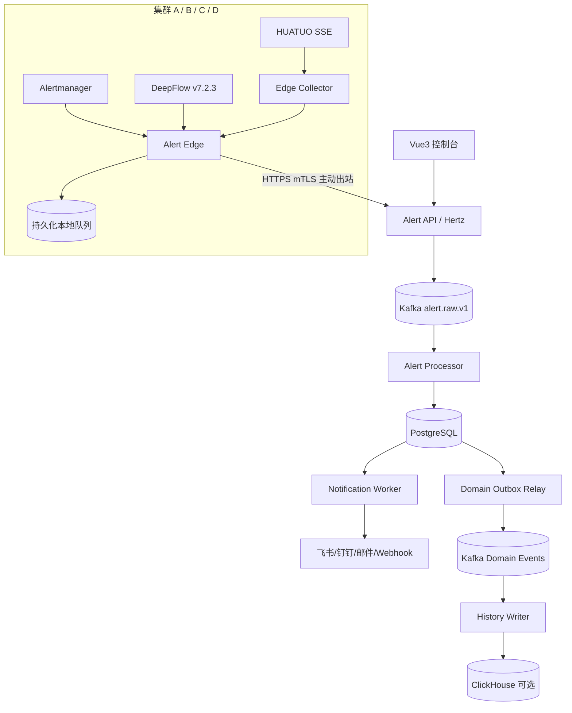

# 02 · 总体架构与服务边界

## 1. 部署模式

采用“中央控制平面 + 多集群数据接入 Edge + 中央异步处理”。数据源的原生协议只出现在 Adapter 边界；平台内部统一用 Protobuf v1 契约。

## 2. 三个主要二进制

### alert-api

- 接受可信 Edge 已规范化的事件批次、对其认证并写 Kafka；写入 Kafka 获得持久化确认后应答。
- 提供数据源、告警、Incident、策略与投递记录 REST API。
- 管理控制面下发带版本的配置快照。
- 不承担通知投递和复杂状态判定。

### alert-edge

- `gateway` 模式：执行来源 Webhook 认证/校验/标准化并持久化到 WAL/SQLite；上报中心。
- `collector` 模式：HUATUO SSE 长连接、节点发现与订阅所有权（按可达性采用 Deployment 分片或 DaemonSet）。
- 断网重试、速率限制、缓冲上限、离线状态监控。
- 不依赖中心主动访问远端 PodCIDR。

### alert-worker

- `processor` 子模块：消费 raw 事件，更新 Alert/Incident 状态，写 Transition + Outbox，提交消费 Offset。
- `notifier` 子模块：从数据库领取 Outbox 任务，执行发送、审计、退避重试。
- `scheduler` 子模块：静默过期、升级、对账与延迟任务。
- `relay` 子模块：将事务提交后的领域事件 Outbox 发布回 Kafka。
- 初期同一仓库/二进制不同 profile；在吞吐和故障隔离需要时拆开 Deployment。

## 3. 技术边界

| 层 | 责任 | 依赖方向 |
| --- | --- | --- |
| Adapter | 厂商协议解析与映射 | Adapter -> Application |
| Application | 用例编排、事务边界、策略调用 | Application -> Domain ports |
| Domain | 告警状态机、Incident、路由计算 | 不依赖 OEKit/Hertz/Kafka/PG |
| Infrastructure | Kafka/PG/HTTP/可观测实现 | 实现 Domain/Application ports |

OEKit 用于 `bootstrap/hertz/logx/tracing/metrics/k8s` 等基础设施；不让 Domain 依赖工具库类型。Kitex 可在未来确有跨进程同步调用时引入。OAgentKit 不进入 V1 核心链路。

## 4. 数据流 ACK 语义

1. 上游 -> Edge：Edge 完成稳定入队后回复成功；网络不可用时保留 WAL，容量不足须返回错误并发出自身告警。
2. Edge -> API：API Kafka 持久化 ACK 后返回 accepted；Edge 收到确认后才能删除本地记录。
3. Kafka -> Processor：DB 原子提交状态/幂等记录/Outbox 后才提交 Offset。
4. Notification：DB claim + lease，第三方调用通常只能做到 at-least-once。

## 5. 拆分边界触发器

- API 和 Processor 的吞吐、延迟指标出现不同扩容需求。
- 通知渠道故障影响 Processing 的 CPU/线程池、资源隔离指标。
- 平台需要独立规则计算 Evaluator 或跨组件同步 RPC。

不要仅因“微服务架构”就让每个领域对象独占一个服务。
