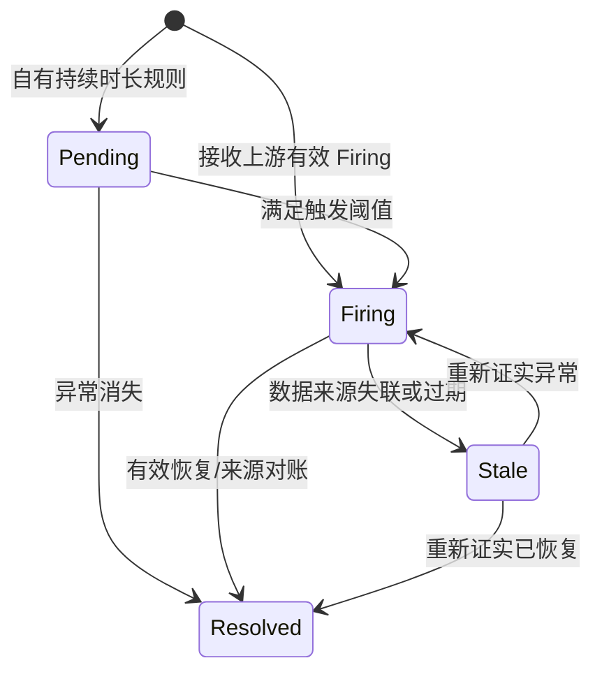

# 03 · 事件模型、幂等与状态机

## 1. 四类核心对象

- `AlertEvent`：一次接入观察，原则上不可变；可能是重复观察，且不一定有 AlertInstance。
- `AlertInstance`：同一 fingerprint、同一 episode 的持续异常及其恢复状态。
- `Incident`：故障处置对象，关联多个告警实例，也允许单告警 Incident。
- `NotificationTask`：一次投递任务，与监控状态分离，支持独立重试与审计。

## 2. 四种 ID 不得混用

- `transport_id`：Edge/API 之间一次稳定排队消息 ID；网络补传必须使用同一个 ID。
- `event_key`：来源层有唯一 ID 则使用 `(tenant, source_id, source_event_id)`；否则根据该源的事件粒度做稳定合成。它不等同于告警指纹。
- `fingerprint`：`SHA256(版本前缀 + tenant + source_instance + rule_id + cluster + entity_type + entity_uid + dimension_labels)`；决定同一逻辑告警（`entity_type` 参与摘要输入，与参考实现 `internal/domain/alert/fingerprint.go` 的 `Identity` 字段一致，防止不同类型对象共用 uid 时误归并）。**摘要必须带指纹版本前缀**（参考实现为 `alert-fingerprint/v1`）：给身份字段扩容时 bump 到 v2 并先排空在途 episode，否则全部活跃告警的指纹瞬间漂移、永远无法关单。
- `episode_key`：同一 fingerprint 新一轮出现的生命周期。重复 Firing 不创建新 episode；恢复后的新 StartsAt/有序新开始创建新 episode。命名与 `event.proto` 的 `episode_key` 字段及 DDL `alert_instances.episode_key` 一致。

## 3. 明确时间语义

- `occurred_at`：来源声称的事件发生时间，可空/质量存疑。
- `received_at`：平台接收时间；不可代替源序号做严格时序判断。
- `starts_at`、`ends_at`：Stateful 告警生命周期边界。
- `last_seen_at`：最近一次收到来源观察，不等于状态转换。
- 对时钟漂移、缺失时间和来源乱序应保留冲突/待对账状态，不盲目更新。

## 4. 监控状态机

一次性 HUATUO OOM 事件属于 `Occurrence`，不强制构造 Firing/Resolved 周期。

## 5. 处置状态机（Incident）

`Open -> Acknowledged -> Mitigated -> Closed`，支持记录原因的人工 Close 和授权的 Reopen。ACK 不改变监控状态。Silenced 为通知策略，不是告警监控状态。

## 6. 重复/乱序处理原则

- 上游重复推送可能意味着重新观察到仍 Firing；可更新 `last_seen_at`，**不得生成第二条状态迁移或第二次相同策略通知**。
- 较旧的 Firing 不能重新打开已根据更晚有效恢复事件关闭的 episode。
- 传输消息至少一次；重复入队、Kafka 重试和消费者重平衡都应使用 DB unique + version 防重。
- 当前例子 `internal/domain/alert/state.go` 仅实现基础纯函数状态迁移逻辑；最终数据库中必须加身份/版本约束。

## 7. 归并与关联是两个维度

1. **Exact idempotency**：同一事件/传输重复不重复生效。
2. **Grouping**：按照 team/service/severity 进行通知聚合，减少噪声。
3. **Incident correlation**：多来源事件基于稳定资源身份、时间窗、拓扑证据建立故障关联；没有证据时只建议而不自动归因。

## 8. 权威来源

上游 Prometheus/DeepFlow 保持监控判定权威；平台是自身处置、通知和告警镜像的权威。来源不可用时标记 Unknown/Stale，不自动标记 Resolved。只有切换到明确的直连/对账模式后才能变更这一协议。
